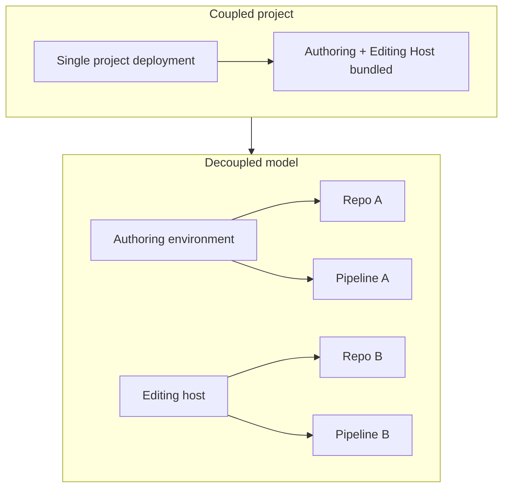

> **TL;DR**
>
> - SitecoreAI **decoupled deployment** splits **authoring** and **editing host** into separately deployable units.
> - Conversion is triggered in Deploy App and redeploys authoring environments and editing hosts.
> - Use **SitecoreAI** (one word) as the product name in new writing; older "Sitecore AI" docs may still appear in product UI.
> - Treat rollback as an operational risk: confirm current recovery options with Sitecore Support / your CSM before converting production.

SitecoreAI (formerly XM Cloud) continues to move editing and authoring toward independently deployable units. Teams that started on a **coupled** project layout eventually need to understand what **decoupled deployment** changes for repositories, pipelines, and release risk.

## 1. Why coupled projects become a constraint

In a coupled model, authoring and editing capabilities ship together. That simplifies the first environment, but it limits:

- Environment-level configuration flexibility
- Independent scaling of editing vs authoring
- Deployment isolation (a frontend/editing change forces a wider blast radius)
- Aligning AI editing features with current SitecoreAI platform standards

Official product documentation for XM Cloud / SitecoreAI deployment models lives under Sitecore's Deploy / documentation portals — always confirm the Convert Project flow against the version of Deploy App your organization uses.

## 2. What decoupled deployment means

| Component | Coupled | Decoupled |
| --- | --- | --- |
| Authoring environment | Bundled with editing | Independently deployed |
| Editing host | Bundled with authoring | Independently deployed |
| Repositories | Often one project tree | Separate repos (typical) |
| Pipelines | Shared or tightly coupled | Environment-specific |
| Configuration | Shared surface area | Granular and isolated |

Outcomes teams usually want:

- Ship editing-host updates without redeploying every authoring environment
- Change authoring configuration without recycling the editing runtime
- Promote environments with clearer ownership boundaries

## 3. Topology after conversion

Each side typically gains:

- Its own source control
- An independent CI/CD lifecycle
- Environment-specific configuration

That matches a SaaS-managed editing host plus separately promoted authoring environments.

## 4. What Convert Project does

In Deploy App the conversion path is conceptually:

> Deploy App → Project → Options → Convert Project → Confirm

Sitecore then:

1. Starts a fresh deployment cycle for the project
2. Redeploys **all authoring environments**
3. Redeploys **all editing hosts**

The conversion is automated from a code-migration perspective, but it is still a **production-affecting platform operation**. Schedule it like a release: communications, freeze window, and a verified smoke plan for authoring and editing.

## 5. DevOps checklist before you convert

- Inventory every pipeline that assumes a single coupled artifact.
- Split secrets and variable groups so authoring and editing do not share unnecessary credentials.
- Confirm Next.js / editing-host build pins (Node version, Content SDK / JSS packages).
- Confirm serialization / content promotion still targets the correct authoring environment after the split.
- Document who owns editing-host releases vs authoring releases.
- Run the conversion first on a non-production project when your license/tenant allows.

## 6. Rollback and recovery

Do not assume a one-click "uncouple undo" exists for every tenant. Sitecore's SaaS deployment surface evolves; recovery after a failed or undesired conversion may require **Sitecore Support** (or your Customer Success contact) to restore project state. Capture:

- Pre-conversion project identifiers and environment names
- Pipeline run IDs and Deploy App activity logs
- A tested content/authoring smoke checklist

Treat Support engagement as part of the runbook, not an afterthought. Verify the current recovery path with Sitecore for your exact Deploy App generation before converting production.

## 7. Spelling: SitecoreAI

This site standardizes on **SitecoreAI**. Product UI and older documents may still say "Sitecore AI" or "XM Cloud." In pipelines and docs for your team, pick one spelling and stick to it in YAML comments, wiki pages, and ticket titles.

## 8. Where to read next

- Sitecore documentation for XM Cloud / SitecoreAI deployment and editing hosts (official docs for your release)
- Related on this site: serialization CI failures, Next.js cache invalidation, and Azure Pipelines agent choice

## Version stamp

Written against SitecoreAI / XM Cloud decoupled-deployment guidance as discussed in early 2026 delivery work. Re-validate Convert Project behavior in your tenant's Deploy App before executing.
